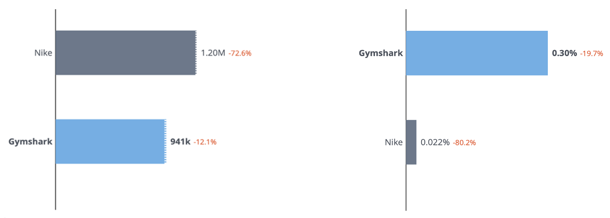
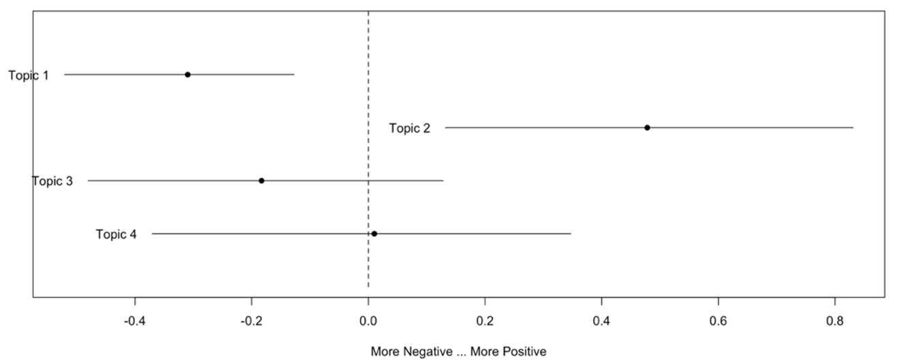
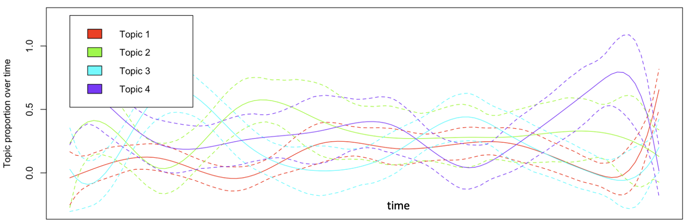

# Gymshark Social Media Marketing Analytics

Competitor benchmarking of Gymshark against Nike on Instagram and X (07 Feb – 08 Mar 2026), combining engagement, reach and audience metrics with AI-assisted topic modelling and sentiment analysis in R to understand what customers say about the brand.

📄 **[Read the full report (PDF)](Gymshark-Social-Media-Marketing-Analytics-Report.pdf)**

## Business Problem
Compared to Nike, how effective is Gymshark's social media strategy at engaging its audience, and what do customers actually think of the brand?

## Data
- **Platforms:** Instagram and X (Twitter)
- **Period:** 07/02/2026 – 08/03/2026
- **Social media metrics:** followers, follower growth, posts, engagement, reach, impressions, audience demographics and Instagram advertisements, taken from publicly available data
- **Customer feedback:** comments on Gymshark's Instagram posts, used for topic modelling and sentiment analysis
- **Privacy note:** raw comments and usernames are not included in this repository.

## Tools Used
- **Claude AI** to group customer comments into topic themes
- **R** for topic modelling and sentiment analysis, used to verify the AI-generated themes

## Approach
- Defined objectives with KPIs:
  1. marketing impact (engagement, reach)
  2. eWOM (advocate influence and impact)
  3. brand image (sentiment ratio, topic trends)
- Ran a social media audit of both brands (content, posting frequency and purpose) and benchmarked engagement, reach, audience demographics and advertising
- Used Claude AI to group Gymshark's Instagram comments into themes, then verified the results with topic modelling and sentiment analysis in R
- Identified four topics and measured sentiment and topic trends over time:
  1. product fit
  2. positive feedback
  3. gym lifestyle
  4. product demand
- Linked the findings to the objectives, built a SWOT analysis and turned the insights into recommendations

## Key Findings
**Engagement and reach**

*Total engagement (left) and engagement rate by followers (right)*

- Nike has about 298M Instagram followers vs Gymshark's 8.4M, yet Gymshark's Instagram engagement rate is 0.30% vs Nike's 0.02%
- On X, Gymshark's engagement rate is 0.44% vs Nike's 0.08%, despite 386K followers vs 9.6M
- Gymshark's followers comment more: 14,803 comments vs Nike's 9,247, with comments making up 1.57% of its engagement against 0.77% for Nike

**Audience and growth**
- Gymshark gained followers on both platforms while Nike lost them over the period
- Gymshark's audience is concentrated in the UK and aged 18–35, while Nike targets wider European markets and ages 18–65+
- Gymshark ran about 523 Instagram ads vs Nike's 227, relying heavily on image-based formats

**Customer sentiment (topic modelling and sentiment analysis)**
- Overall brand sentiment is positive, with "positive feedback" the most positive topic, showing strong eWOM
- Product fit is the main customer concern, with slightly negative sentiment, followed by gym lifestyle
- Product demand is the most discussed topic and rises and falls over time, likely tied to promotions and launches

*Four customer topics identified from Instagram comments*

*Sentiment by topic, from more negative to more positive*

*How topic prevalence changes over time*

## Recommendations
1. **Product-focused content:** publish product reviews, sizing guidance, try-on videos and authentic customer feedback to address the product fit concern
2. **Expand collaborations:** partner with well-known fitness personalities and athletes, as Nike does with Olympic athletes, to widen visibility
3. **Increase global audience:** create region-specific campaigns and content for wider age groups and international markets
4. **Encourage user-generated content:** run fitness challenges and repost customer content to build on strong eWOM
5. **Align content with key events:** tie content to seasonal trends and fitness events to lift engagement

## Author
Hashen Rathnayake | [LinkedIn](https://www.linkedin.com/in/hashen-rathnayake-074885207/)
